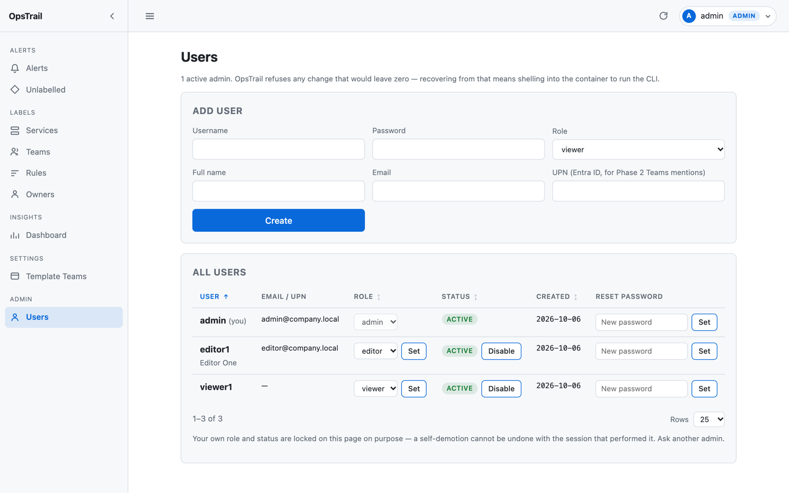

# Quản trị

Người dùng, phân quyền, nhật ký thao tác và vòng đời dữ liệu.

## Tạo user đầu tiên

Bảng `users` khởi đầu **rỗng**. Không có bước này thì không ai đăng nhập được:

```bash
docker compose exec opstrail python -m app.cli create-user \
  --username admin --role admin --email admin@company.local
```

Mật khẩu nhập tương tác qua `getpass` — không nhận qua tham số dòng lệnh để
không lọt vào shell history và process list.

```bash
docker compose exec opstrail python -m app.cli list-users
docker compose exec opstrail python -m app.cli set-password --username admin
```

Sau đó quản lý user trên UI tại **Admin → Users** (chỉ `admin` vào được).

## Phân quyền



| Vai trò | Được làm |
|---|---|
| `viewer` | Chỉ đọc mọi trang |
| `editor` | + gán nhãn tay, thêm/xoá service/team/rule, chạy backfill |
| `admin` | + quản lý user |

Đăng nhập sai trả về đúng **một** thông báo cho mọi trường hợp (user không tồn
tại, sai mật khẩu, tài khoản bị khoá) để không dò được tài khoản nào có thật.

Tắt `is_active` là session bị huỷ ngay request kế tiếp, không chờ cookie hết hạn.

## Chống tự khoá

`/users` từ chối mọi thao tác làm hệ thống không còn admin dùng được:

- Không tự đổi vai trò của chính mình (dropdown bị khoá ngay trên UI)
- Không tự tắt tài khoản của chính mình
- Không hạ/tắt admin đang hoạt động cuối cùng

Thiếu mấy chốt này thì một cú bấm nhầm là phải `docker compose exec` vào
container chạy CLI để cứu.

> Chốt thứ ba hiện **không kích hoạt được** qua UI: người thao tác luôn là một
> admin đang hoạt động, nên trừ target ra vẫn còn ít nhất một. Nó là phòng thủ
> chiều sâu cho trường hợp sau này cho phép tự hạ vai trò.

## Audit log

Mọi thay đổi user, service, team, rule, gán nhãn tay và backfill đều ghi vào
bảng `audit_log` kèm giá trị **trước → sau**:

```sql
SELECT u.username AS actor, a.action, a.object_type, a.object_id,
       a.detail, a.created_at
FROM audit_log a LEFT JOIN users u ON u.id = a.user_id
ORDER BY a.created_at DESC LIMIT 50;
```

Chưa có trang xem audit_log trên UI.

## Mật khẩu: bcrypt trực tiếp, không passlib

`passlib` (lựa chọn mặc định của hầu hết hướng dẫn) phát hành lần cuối 2020 và
**hỏng hẳn với bcrypt 5.x** — nó đọc `bcrypt.__about__` đã bị xoá rồi raise ở
mọi lần hash. `app/security.py` dùng `bcrypt` trực tiếp, pre-hash SHA-256 +
base64 để mật khẩu dài hơn 72 byte không bị cắt âm thầm.

## Retention

Chạy 03:00 UTC hằng ngày, xoá theo batch 5000 để không giữ lock lâu.
`notifications` xoá theo cascade. Mặc định giữ **6 tháng**
(`ALERT_RETENTION_MONTHS`, đặt `0` để tắt).

Nếu vượt ~100k alert/tháng thì chuyển `alerts` sang partition theo tháng và đổi
sang `DROP PARTITION`.

---

[← Về README](../README.md)
