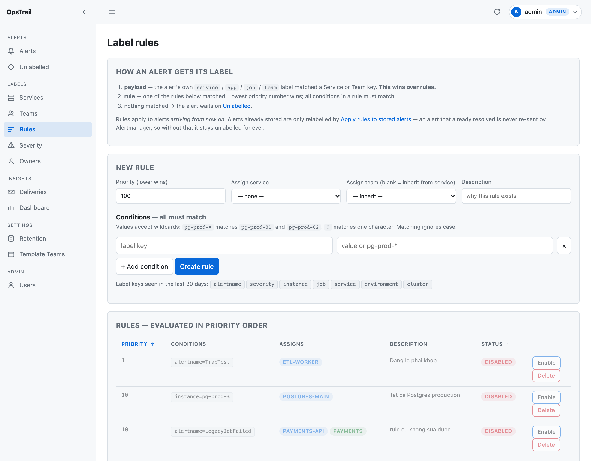
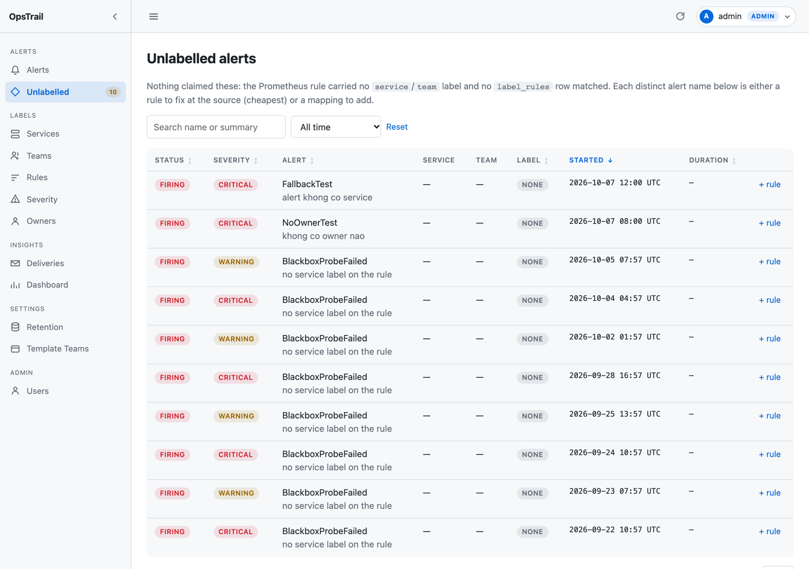

# Gán nhãn service / team

Cách OpsTrail quyết định một alert thuộc về service và team nào, và cách điều
khiển việc đó **không cần sửa alerting rule ở Prometheus**.

Quản lý toàn bộ trên UI tại **Labels → Services / Teams / Rules**. Chính trang
Rules cũng nhắc lại ba bước này ngay đầu trang:



## Ba bước, chạy cho mọi alert vào

`label_source` trên mỗi alert ghi lại nhãn đến từ đâu.

### 1. `payload` — nhãn nằm sẵn trong alert

OpsTrail đọc các key sau và đem **giá trị** đi tra vào `services.key` /
`teams.key`:

| Chiều | Key, theo thứ tự ưu tiên |
|---|---|
| service | `service` → `service_name` → `servicename` → `app` → `application` → `component` → **`job`** |
| team | `team` → `squad` → `owner` → `owner_team` |

Rẻ nhất và chính xác nhất:

```yaml
- alert: PostgresqlDown
  labels:
    severity: critical
    service: payments-api     # khớp services.key
    team: payments            # khớp teams.key
```

`job` để cuối vì nó thường là scrape target chứ không phải service.

> **So khớp không phân biệt hoa thường.** `service=Payments-API` khớp service
> key `payments-api`. Trước đây chỗ này so khớp chính xác và hỏng im lặng —
> alert rơi thẳng xuống backlog mà không có gì nói vì sao.

### 2. `rule` — label rule bạn tạo

Cho rule cũ chưa sửa được. Khớp trên **bất kỳ label key nào** có trong alert:
`alertname`, `instance`, `job`, `namespace`, `severity`...

Mọi điều kiện trong một rule phải cùng đúng (AND). `priority` **nhỏ thắng**.

Form tạo rule gợi ý sẵn các label key thực sự có trong alert 30 ngày gần đây,
chọn key xong thì ô giá trị gợi ý tiếp các giá trị đã gặp — không phải gõ mò.

### 3. Không khớp gì → `/unlabelled`

Mỗi alertname ở đó là một rule còn thiếu. Badge trên sidebar hiện số lượng.

```sql
SELECT alertname, count(*) FROM alerts WHERE label_source IS NULL
GROUP BY 1 ORDER BY 2 DESC;
```

## ⚠️ `payload` luôn thắng `rule`

`job` nằm sẵn trong danh sách key tự động ở bước 1. Nếu bạn tạo service key
`node-exporter` thì **mọi** alert mang `job=node-exporter` sẽ tự gán theo đó,
và rule của bạn **không bao giờ chạy** — kể cả rule `priority=1`.

Đã kiểm chứng bằng thực nghiệm và cố định bằng test
(`tests/test_backfill.py::test_payload_attribution_beats_even_priority_one_rule`).

→ Khi đặt `key` cho service, **tránh trùng tên scrape job** trừ khi bạn thực sự
muốn mọi alert của job đó thuộc về service đó.

## Wildcard trong rule

Giá trị nhận `*` và `?` kiểu glob, không phân biệt hoa thường:

```
instance = pg-prod-*     khớp pg-prod-01, pg-prod-02; không khớp pg-stg-01
instance = node-?        khớp node-1; không khớp node-12
alertname = *Probe*      khớp BlackboxProbeFailed
disk     = 100%          là giá trị literal, KHÔNG phải wildcard
```

Một module `app/services/globmatch.py` lo cả hai đường: `fnmatch` cho lúc
ingest, dịch sang `ILIKE` cho preview/backfill chạy trong DB. Hai đường phải
cho cùng kết quả — nếu lệch thì preview nói một đằng, ingest làm một nẻo.

Label không tồn tại thì **không khớp**, kể cả pattern `*`.

## Backfill — áp rule cho alert đã lưu

Rule chỉ ăn với alert mà Alertmanager **còn gửi lại**. Alert đã resolved không
bao giờ được gửi lại, nên nếu không có backfill thì nó kẹt không nhãn vĩnh viễn.

**Labels → Rules → Apply rules to stored alerts**:

1. **Preview** — bảng nhóm theo alertname kèm service/team sẽ được gán và số
   lượng. Tính bằng **đúng hàm `labeling.resolve()` mà ingest dùng**, nên
   preview chính là kết quả thật và tôn trọng thứ tự priority.
2. **Apply** — ghi theo lô, ghi `audit_log`.

Chỉ chạm alert có `label_source IS NULL`. **Nhãn gán tay không bị đụng** —
`manual` là quyết định của người vận hành.

## Tạo rule từ alert chưa gán nhãn



Trên `/unlabelled`, mỗi dòng có nút **+ rule** mở form đã điền sẵn label của
alert đó (`severity` bị loại vì không phải chiều gán nhãn). Đây là luồng nhanh
nhất: thấy alert lạ thì tạo rule ngay tại chỗ.

## Gán nhãn tay


Trên trang chi tiết alert, ghi `label_source='manual'`.

**Nhãn tay là bản vá tạm khi nguồn chưa nói được, không phải quyết định vĩnh
viễn.** Thứ tự đầy đủ:

```
payload  >  manual  >  rule  >  chưa gán
```

| Tình huống | Kết quả |
|---|---|
| Label của alert tra ra Service/Team | **Nguồn thắng**, kể cả khi đang có nhãn tay |
| Label không tra ra gì, có rule khớp | Nhãn tay thắng rule |
| Label không tra ra gì, không rule nào khớp | Nhãn tay giữ nguyên |
| Chưa ai gán tay | `payload` → `rule` → chưa gán, như trên |

Lý do `payload` thắng `manual`: tình huống thật hay gặp nhất là alert **vẫn
luôn** mang `service=billing-api`, nhưng chưa ai khai Service đó nên nó vào
backlog và người trực gán tay một chỗ gần đúng. Khi Service được khai, nhãn
tay trở thành thứ đang nói sai về quyền sở hữu — Alertmanager mới là sổ gốc.

Lý do `rule` **không** thắng `manual`: rule cũng chỉ là phỏng đoán của
OpsTrail, và một phỏng đoán không được đè lên quyết định của con người.

Mỗi lần OpsTrail tự đổi nhãn như vậy đều ghi **audit log** với `user_id` rỗng
— không ai thực hiện, nên nó càng cần được ghi lại: một attribution tự dịch
chuyển mà không có người đứng sau thì không phân biệt được với lỗi.

| Action | Khi nào |
|---|---|
| `alert.label.superseded` | Nguồn tiếp quản nhãn tay |
| `alert.label.lost` | Rule bị xoá/tắt làm alert mất nhãn ở lần lặp kế |
| `alert.label.orphaned` | Xoá service/team khiến alert quay về backlog |

Nhãn tự động (`payload`/`rule`) được làm mới ở **mọi** lần lặp, nên thêm một
rule sẽ gán nhãn hồi tố cho alert đang được gửi lại — và xoá một rule cũng sẽ
gỡ nhãn của chúng.

## Sửa label ở nguồn Alertmanager thì sao?

Câu trả lời ít ai đoán đúng: **không sửa dòng cũ, mà sinh dòng mới.**

OpsTrail lưu `fingerprint` nguyên văn từ Alertmanager, và fingerprint là hash
của **toàn bộ tập label**. Thêm hay sửa `service=` trong alerting rule là đổi
fingerprint → khoá `(fingerprint, starts_at)` không trùng → `INSERT` dòng mới.

Hệ quả cần biết trước khi sửa rule Prometheus:

- Alert cũ **giữ nhãn cũ vĩnh viễn**. Backfill cũng không đụng, vì nó chỉ quét
  `label_source IS NULL`.
- Thống kê lịch sử sẽ thấy cùng một alert nằm ở hai attribution, cắt đúng
  ngày bạn sửa.
- Chỉ alert **đang còn được gửi lại** mới được gán nhãn lại.

## Xoá service / team

- `alerts.service_id` là `ON DELETE SET NULL` → alert sống sót nhưng **mất nhãn**
  và được đưa **trở lại backlog** `/unlabelled` để còn gán lại được. Thiếu
  bước đó thì chúng mang `label_source` cũ nhưng không trỏ vào đâu — vô hình
  với cả trang Unlabelled lẫn backfill, và kẹt ở đó vĩnh viễn
- `label_rules.service_id` là `ON DELETE CASCADE` → **rule trỏ vào nó bị xoá theo**

Hộp xác nhận trên UI nói rõ cả hai con số trước khi hỏi.

---

[← Về README](../README.md)
