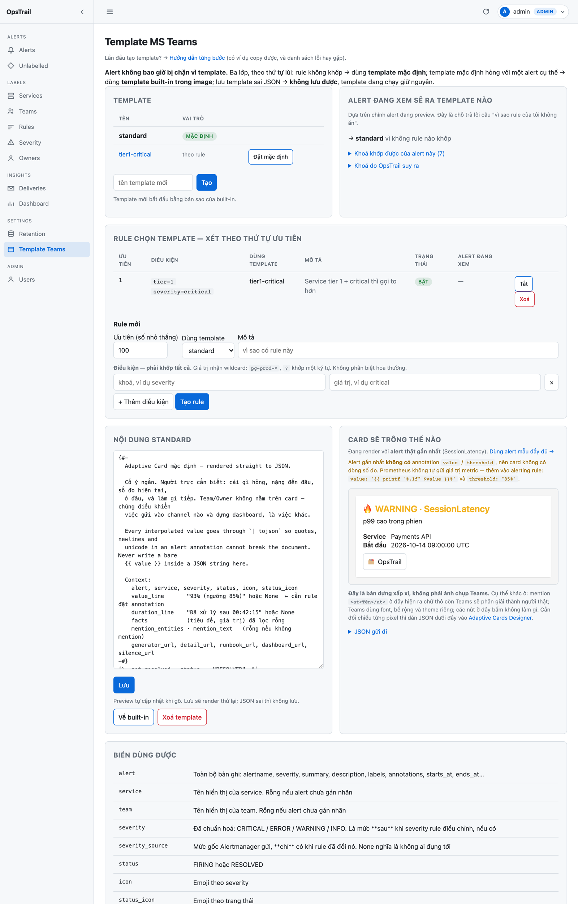

# Template card MS Teams

> Lần đầu tạo template? Bắt đầu ở
> **[Hướng dẫn tạo template](teams-template-howto.md)** — từng bước, có ví dụ
> copy được. Trang này là tham chiếu.

Sửa tại **Settings → Template Teams**. Lưu vào database nên **không cần deploy
lại**. Chưa tạo template nào thì dùng bản mặc định trong image.

## Nhiều template, chọn theo rule

Một card chung cho cả sự cố sàn giao dịch lẫn ổ đĩa sắp đầy ở staging là
không đúng. OpsTrail cho tạo nhiều template và chọn bằng **rule**:

| | |
|---|---|
| **Template mặc định** | Dùng khi không rule nào khớp. Đúng một cái mỗi channel, ép ở DB |
| **Rule** | Điều kiện + độ ưu tiên. **Số nhỏ thắng**. Rỗng thì không khớp gì |

Rule viết giống hệt [label rule](labelling.md): `{khoá: giá trị}`, mọi điều
kiện phải khớp, giá trị nhận wildcard `pg-prod-*`, không phân biệt hoa thường.



### Khoá khớp được

Toàn bộ **label nguyên văn** mà Alertmanager gửi — `severity`, `alertname`,
`instance`, `environment`, … — cộng vài khoá OpsTrail tự suy ra:

| Khoá | Ở đâu ra |
|---|---|
| `status` | `firing` / `resolved`. Không bao giờ là label — Alertmanager gửi riêng |
| `tier` | Tier của service, khai ở **Labels → Services**. Chưa khai thì **không có khoá này**, nên rule có điều kiện `tier` đơn giản không khớp — không đoán, không bịa |
| `resolved_service`, `resolved_team` | Key sau khi gán nhãn. Khác `service` khi nhãn đến từ rule chứ không từ label |
| `service`, `team` | Chỉ điền khi alert **không** tự mang label cùng tên |

> **Label của Alertmanager luôn thắng khoá suy ra.** Alert gửi
> `service=payments-api-v2` trong khi OpsTrail gán nhãn thành `payments-api`
> thì `service` giữ nguyên giá trị Alertmanager gửi; muốn khớp theo kết quả
> gán nhãn thì dùng `resolved_service`. OpsTrail không sửa dữ liệu nguồn.

Trang có sẵn hộp **"Alert đang xem sẽ ra template nào"**: liệt kê đúng những
khoá alert đó có, rule nào khớp, template nào thắng. Điều kiện đặt trên khoá
không nằm trong danh sách đó thì **không bao giờ** khớp — đây là lỗi rule hay
gặp nhất.

### Ví dụ

```
ưu tiên 1    severity=critical, tier=1     → tier1-critical
ưu tiên 10   environment=staging           → quiet
ưu tiên 100  (không có rule)               → template mặc định
```

## Xem trước card

Trang dựng **hình card thật** ngay khi gõ, không phải reload. JSON sai thì
hiện lỗi chứ không giữ lại hình cũ để đánh lừa.

> Đây là bản dựng **xấp xỉ**, không phải ảnh chụp Teams. Khác cụ thể ở:
> mention `<at>Tên</at>` hiện ra chữ thô trong khi Teams phân giải thành
> người thật; Teams dùng font, bề rộng, theme riêng; nút bấm ở đây trơ.
> Cần đối chiếu từng pixel thì dán JSON vào
> [Adaptive Cards Designer](https://adaptivecards.io/designer).

Chuyển giữa **alert thật gần nhất** và **alert mẫu đầy đủ** bằng link ngay
trên khung preview — alert thật cho thấy hình dạng dữ liệu của chính bạn,
alert mẫu cho thấy card khi mọi trường đều có.

## Alert không bao giờ bị chặn vì template

Ba lớp bảo vệ, đều có test:

**Lớp 0 — lúc chọn.** Rule hỏng, template bị xoá, truy vấn lỗi: tất cả rơi về
template mặc định, rồi về built-in. Một quyết định định tuyến **không bao giờ**
là lý do card không đi.

**Lớp 1 — lúc lưu.** Template được render thử với **cả hai**: alert thật gần
nhất và alert mẫu đầy đủ. JSON sai thì **không lưu được**. Kiểm theo từng
template, vì rule làm một template trở nên với tới được bởi những alert mà
người viết nó chưa từng xem.

**Lớp 2 — lúc gửi.** Template hợp lệ với alert mẫu vẫn có thể hỏng với một
alert cụ thể (ví dụ alert không có service mà template lại gọi
`service.upper()`). Khi đó OpsTrail **tự dùng template mặc định**, ghi lý do
vào `notifications.last_error`, và log mức ERROR.

```sql
-- template tuỳ chỉnh có đang hỏng âm thầm không
SELECT count(*), left(last_error, 70)
FROM notifications
WHERE last_error LIKE 'custom template failed%'
  AND created_at > now() - interval '7 days'
GROUP BY 2;
```

Thiếu lớp 2 thì một template gõ sai sẽ chặn **toàn bộ** alert ra Teams mà
không ai hay — đúng lúc cần nhất.

## Cú pháp

Jinja2, xuất thẳng JSON Adaptive Card.

> **Mọi giá trị phải đi qua `| tojson`.** Đừng viết `{{ value }}` trần bên
> trong chuỗi JSON — một dấu nháy trong annotation là hỏng cả document.

```jinja
{ "type": "TextBlock", "text": {{ alert.summary | tojson }}, "wrap": true }
```

## Biến dùng được

| Biến | Nội dung |
|---|---|
| `alert` | Bản ghi đầy đủ: `alertname`, `severity`, `summary`, `description`, `labels`, `annotations`, `starts_at`, `ends_at`, `fingerprint`… |
| `service` · `team` | Tên hiển thị; rỗng nếu alert chưa gán nhãn |
| `severity` | Đã chuẩn hoá: `CRITICAL` / `ERROR` / `WARNING` / `INFO` |
| `status` | `FIRING` / `RESOLVED` |
| `icon` · `status_icon` | Emoji tương ứng |
| `facts` | Danh sách `(tiêu đề, giá trị)` **đã lọc bỏ trường rỗng**. Rút gọn: Service · Instance · Cluster · Namespace · Environment · Bắt đầu · Kết thúc |
| `value_line` | `93% (ngưỡng 85%)`. **None** nếu rule không gửi — xem [Alertmanager](alertmanager.md#ngưỡng-và-giá-trị-hiện-tại) |
| `duration_line` | `Đã xử lý sau 00:42:15`. None khi alert chưa kết thúc |
| `owners` | Tên người phụ trách (có kể cả khi không mention) |
| `mention_entities` | Khối `msteams.entities`. **Rỗng** nếu chưa đạt ngưỡng hoặc chưa có owner |
| `mention_text` | Chuỗi `<at>Tên</at>` khớp với entities. Rỗng khi không mention |
| `generator_url` | Link đồ thị Prometheus |
| `detail_url` | Link trang chi tiết OpsTrail |
| `runbook_url` · `dashboard_url` | Từ annotation `runbook_url` / `dashboard_url` |
| `silence_url` | Link tạo silence trong Alertmanager, dựng từ `external_url` |

### Ẩn trường rỗng

Luôn bọc trong ``. Alert của bạn hiện chỉ mang `summary` và vài label,
nên template cứng sẽ ra một cột dấu gạch ngang:

```jinja
,
{ "type": "TextBlock", "text": {{ alert.description | tojson }}, "wrap": true }

```

### Mention

Chỉ `TextBlock` và `FactSet` hiển thị được mention. Đặt ở chỗ khác thì Teams
hiện ra chữ `<at>Tên</at>` thô.

```jinja
,
{ "type": "TextBlock", "text": {{ mention_text | tojson }}, "wrap": true }

```

Và khối entities trong `msteams`:

```jinja
"msteams": {
  "width": "Full"
  ,
  "entities": [
    
    { "type": "mention",
      "text": {{ e.text | tojson }},
      "mentioned": { "id": {{ e.mentioned.id | tojson }},
                     "name": {{ e.mentioned.name | tojson }} } }{{ "," if not loop.last }}
    
  ]
  
}
```

Cả hai dựng từ **cùng một nguồn** (`mention_entities`) để `text` không bao giờ
lệch nhau.

## Template mặc định đang có gì

Cố ý ngắn. Team và Owner **không** nằm trên card — chúng quyết định gửi vào
channel nào và dựng dashboard, là việc khác với việc nói cho người đang nhìn
card biết phải xem gì.

### FIRING

```
🔥 CRITICAL · HighCPU                 ← severity ở tiêu đề, không phải một dòng fact
<at>Nguyen Van A</at> — cần xử lý     ← chỉ khi đạt ngưỡng mention

93% (ngưỡng 85%)                      ← dòng nổi bật
CPU cao trên pg-prod-01

Service    payments-api
Instance   pg-prod-01
Cluster    prod-hcm
Bắt đầu    09:12:04

[📖 Runbook] [🔍 Prometheus] [🗂 OpsTrail] [🔕 Silence]
```

### RESOLVED

```
✅ RESOLVED · HighCPU

Đã xử lý sau 00:42:15                 ← thay chỗ dòng giá trị

Service    payments-api
Instance   pg-prod-01
Bắt đầu    09:12:04
Kết thúc   09:54:19

[🗂 OpsTrail]
```

**Không mention** khi resolved — việc đã xong, không cần đánh thức ai.
**Không nút Silence** — không còn gì để tắt.

Nút **Silence** (chỉ trên card firing) dựng sẵn matcher `alertname` và
`instance` — người trực lúc 3 giờ sáng không phải gõ lại.

### Nên thêm annotation gì vào alerting rule

```yaml
annotations:
  summary: "Postgres down ({{ $labels.instance }})"
  value: '{{ printf "%.1f" $value }}%'    # -> dòng "93% (ngưỡng 85%)"
  threshold: "85%"
  runbook_url: "https://wiki.company.local/runbooks/postgres-down"
  dashboard_url: "https://grafana.company.local/d/abc/postgres"
  impact: "Thanh toán không xử lý được giao dịch mới."
```

`value` và `threshold` là **bắt buộc nếu muốn thấy số đo** — Prometheus không
tự gửi. Chi tiết và các tên key đồng nghĩa ở
[Alertmanager](alertmanager.md#ngưỡng-và-giá-trị-hiện-tại).

`impact` hiện bằng màu cảnh báo — người đọc biết ngay việc này ảnh hưởng gì
mà không phải mở runbook.

## Xem trước

Nút **Xem trước** render với alert **thật gần nhất** (không phải dữ liệu bịa),
hiện JSON. Copy dán vào [Adaptive Cards Designer](https://adaptivecards.io/designer)
để xem hình thật trước khi gửi lên Teams.

## Quay về mặc định

Nút **Về mặc định** xoá template tuỳ chỉnh. Bản trong image luôn còn đó, không
mất đi đâu.

---

[← Về README](../README.md) · [Metadata & owner](metadata.md)
