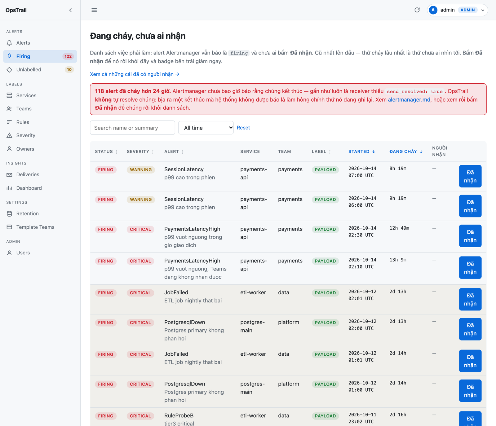

# Giao diện quản trị


## Điều hướng

Sidebar trái, thu gọn được bằng nút `«` — trạng thái lưu `localStorage` và áp
**trước khi render** nên không nhảy layout. Dưới 860px sidebar thành lớp phủ,
mở bằng hamburger, đóng bằng Esc.

Mục **Unlabelled** mang badge số lượng alert đang chờ gán nhãn.

Thu gọn rồi chỉ còn dải biểu tượng, phần nội dung rộng thêm:


| Trang | Có gì |
|---|---|
| `/alerts` | Danh sách, filter, sắp xếp, phân trang |
| `/alerts/{id}` | Chi tiết + lịch sử delivery + gán nhãn tay |
| `/firing` | **Việc phải làm**: alert đang cháy mà chưa ai nhận |
| `/unlabelled` | Backlog alert chưa ai gán nhãn, có nút `+ rule` |
| `/deliveries` | Mọi lần gửi: lọc theo channel, kết quả, service, team, thời gian |
| `/deliveries/{id}` | Một lần gửi: mã HTTP, số lần thử, lỗi đầy đủ, alert liên quan |
| `/dashboard` | 8 biểu đồ, lọc theo service/team/thời gian |
| `/labels/services` · `/labels/teams` · `/labels/rules` | Quản lý nhãn |
| `/settings/retention` | Hai cửa sổ retention, số sẽ xoá, nút chạy ngay |
| `/users` | Quản lý user — chỉ admin |
| `/docs` | Swagger của API |

Trang chi tiết gom bốn thứ người trực cần cùng lúc: nhãn đến từ đâu, mốc thời
gian, **lịch sử gửi từng kênh** (kèm mã HTTP và lỗi nếu có), và toàn bộ
label/annotation gốc. Khối *Set label by hand* ghi nhãn `manual` — Alertmanager
gửi lại cũng không ghi đè.


`/alerts/{id}` **không phải route tuỳ chọn**: `app/notifiers/msteams.py` đã gắn
`detail_url = {public_host}/alerts/{id}` vào nút *Open in OpsTrail* trên mọi
Adaptive Card đã gửi. Đổi tên route là mọi card cũ trong Teams trỏ vào 404.

## Bảng dữ liệu

**Sắp xếp** — bấm vào tiêu đề cột, bấm lại để đổi chiều. Cột sắp xếp được khai
báo sẵn theo từng trang; giá trị lạ trong `?sort=` rơi về mặc định chứ không
lỗi. Tên cột **không bao giờ** lấy thẳng từ URL.

`severity` sắp theo **mức độ** (critical → error → warning → info) chứ không
theo bảng chữ cái. `duration` của alert đang firing là NULL nên xếp cuối.


Mọi thứ tự đều kết thúc bằng khoá chính. Thiếu khoá phụ này thì sắp theo cột
nhiều giá trị trùng kèm `LIMIT/OFFSET` sẽ làm một bản ghi xuất hiện ở hai
trang và một bản ghi khác biến mất.


**Số dòng** — chọn 25 / 50 / 100 ở góc phải thanh phân trang. Giá trị ngoài
danh sách rơi về mặc định. Đổi số dòng hoặc đổi cột sắp xếp đều quay về trang
1 và **giữ nguyên filter** đang áp.

## Khoảng thời gian

Bộ chọn dùng chung cho **Alerts**, **Unlabelled**, **Deliveries** và
**Dashboard**: vài mốc tương đối sẵn (`Last 1d/7d/30d/90d`), hoặc chọn
**Khoảng cụ thể…** để hiện hai ô nhập ngày giờ.


Khoảng tuyệt đối đi vào URL (`?from=…&to=…&tz_offset=…`) nên dán được vào
ticket, và bấm từ ô số liệu trên dashboard sang Alerts thì khoảng đang xem đi
theo — hai trang không nói hai con số khác nhau.

### Múi giờ

Nhập và hiển thị theo **múi của máy bạn**, đổi về UTC trong menu tài khoản.
Nhãn múi giờ luôn hiện cạnh mốc thời gian (`2026-10-12 09:01 UTC+07:00`) để
không ai phải đoán.

Múi giờ **không chỉ là chuyện hiển thị**: nó quyết định ranh giới ngày trên
biểu đồ. 22:00 UTC là 05:00 **hôm sau** ở Việt Nam, nên gom theo ngày UTC mà
dán nhãn giờ địa phương sẽ xếp alert buổi sáng vào ngày hôm trước. Cả biểu đồ
*Alerts per day* lẫn heatmap giờ/thứ đều cắt theo múi của bạn.

Trước khi JS chạy, trang hiện sẵn giờ UTC — đọc được ngay, và nếu JS không
chạy thì vẫn đúng, chỉ là không đổi sang giờ địa phương.

Khoảng ngắn (≤ 2 ngày) tự chia theo **giờ** thay vì theo ngày; dài hơn thì
theo ngày — 3 ngày đã là 72 điểm trên một biểu đồ cao 150px.

## Theme sáng / tối

Nút ☀ / 🌙 / 🖥 trong dropdown tài khoản góc phải. Lần đầu theo cài đặt hệ
điều hành; chọn rồi thì ghi `localStorage`. Script đặt theme nằm inline trong
`<head>` nên không nháy trắng khi tải trang ở chế độ tối.


Biểu đồ **vẽ lại** khi đổi theme. Canvas không phải CSS: thứ đã vẽ giữ nguyên
màu lúc tạo, nên nếu không vẽ lại thì bấm "Light" xong chữ trên biểu đồ gần như
vô hình.

## Đang cháy, chưa ai nhận



`/alerts?alert_status=firing` hiện đúng những dòng này. Thứ trang Firing thêm
vào là nút **Đã nhận** — và nhờ nó, con số trên sidebar mới là **việc phải
làm**: nó giảm khi có người hành động, trong khi một con số "đang cháy" thuần
tuý chỉ giảm khi hệ thống tự hết lỗi.

**Cũ nhất lên đầu**, ngược với trang Alerts. Trên một danh sách việc, thứ cháy
lâu nhất là thứ chưa ai nhìn tới.

Cột **Đang cháy** đếm từ lúc alert bắt đầu tới hiện tại, cập nhật mỗi phút
ngay trên trình duyệt. Mọi chỗ khác trong OpsTrail đo khoảng đã kết thúc
(`ends_at - starts_at`); đây là chỗ duy nhất đếm tới *bây giờ*, nên nó phải
tự chạy — một con số thời gian đứng yên là thông tin sai trông như dữ liệu.

### Vòng đời một lần nhận

| Chuyện gì xảy ra | Nhận còn không |
|---|---|
| Alertmanager gửi lại | **Còn** — lặp lại không phải sự kiện mới |
| Chuyển sang resolved | **Còn** — đây là bản ghi ai đã xử lý |
| Cháy lại sau khi resolved | **Mất** — nó hỏng lại, cần người lần nữa |
| Xoá tài khoản người đã nhận | **Còn** — dòng không âm thầm quay lại hàng đợi |

Viewer bấm "Đã nhận" được; **bỏ nhận** thì chỉ chính người đã nhận hoặc
editor — xem [administration.md](administration.md#vì-sao-viewer-ghi-được-một-thứ).

### ⚠️ Alert cháy mãi không tắt

Dòng cháy quá 24 giờ được tô nhạt. Nguyên nhân gần như luôn là receiver thiếu
`send_resolved: true`, nên OpsTrail **chưa bao giờ** được báo là nó đã tắt —
xem [alertmanager.md](alertmanager.md).

OpsTrail **không** tự resolve những dòng này. Bịa ra một kết thúc mà hệ thống
không được báo là làm hỏng chính thứ nó đang ghi lại. Cách thoát là người xem
rồi bấm "Đã nhận" — một quyết định của người, được ghi lại như quyết định của
người.

## Lịch sử gửi

Biểu đồ *Delivery outcome* trên dashboard nói **bao nhiêu** lần gửi hỏng.
`/deliveries` nói **lần nào**, và đầu bên kia trả lời gì.


Khoảng thời gian ở đây tính theo lúc **thử gửi**, không phải lúc alert bắt
đầu — khác có chủ ý với biểu đồ trên dashboard. Một lần thử lại hôm nay của
alert hai ngày trước vẫn thuộc "Last 1d", vì trang này nói về việc gửi.

Bấm vào dòng để mở chi tiết. Chi tiết là **trang riêng** chứ không phải dòng
xổ ra: `last_error` giữ tới 2000 ký tự, và khi template tuỳ chỉnh hỏng thì cả
output render nằm trong đó — thứ hữu ích nhất trên trang và không thể đọc
trong một ô bảng.


### URL webhook là bí mật

Cột *Target* luôn hiện dạng rút gọn. URL Power Automate đầy đủ **chính là**
thông tin xác thực — ai có nó là gửi được vào channel. Chỉ `admin` xem được
đầy đủ, và lần xem đó ghi vào audit log.

## Retention


Hai cửa sổ chạy mỗi ngày một lần, và trang này cho **chạy ngay** để khỏi phải
đợi tới 03:00 rồi đi đọc log. Số "sẽ xoá ở lần chạy tới" tính bằng đúng điều
kiện mà job dùng, nên nó là con số thật chứ không phải ước lượng.

Dòng **đang chờ gửi lại** không bao giờ bị xoá, dù cũ đến đâu.

## Dashboard

Tám biểu đồ, lọc chung theo service / team / khoảng thời gian. Mỗi biểu đồ trả
lời một câu hỏi vận hành cụ thể — *rule nào ồn nhất*, *nhãn đến từ đâu*, *còn
bao nhiêu alert chưa ai nhận*:


Khối **How long alerts stay firing** ghi rõ **không phải MTTR**: đó là thời
gian điều kiện alert còn đúng. Rule flapping cắt một sự cố thành nhiều cặp
ngắn, nên MTTR thật cần bảng `incidents` ở Phase 2.

## Tài sản tĩnh: vendor, không CDN

HTMX và Chart.js nằm trong `app/static/vendor/`, commit thẳng vào repo. On-prem
thường chặn egress, và một dashboard trắng trơn vì CDN bị chặn là lỗi rất khó
đoán.

## Làm mới ảnh chụp trong tài liệu

Ảnh trong `docs/images/` chụp bằng `deploy/screenshots.py` — chạy tay sau khi
đổi giao diện, không nằm trong image và không có trong CI:

```bash
pip install playwright
OPSTRAIL_ADMIN_PASSWORD=... python deploy/screenshots.py
cd docs/images && for f in *.png; do sips --resampleWidth 1600 "$f"; done
```

---

[← Về README](../README.md)
